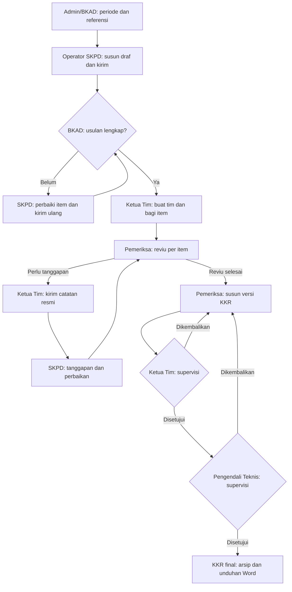

# Alur pengajuan sampai KKR final

Pemetaan implementasi pada 5 November 2026. Titik akhir alur adalah hasil reviu
dan KKR final yang diarsipkan; penetapan SHS/SBU menjadi peraturan resmi belum
termasuk dalam alur aplikasi.

| Tahap | Aktor | Menu/rute | Tindakan dan keluaran |
|---|---|---|---|
| Persiapan | Admin/BKAD | `/periode`, `/referensi/barang`, `/referensi/rekening`, `/referensi/satuan` | Buka periode dan siapkan referensi aktif; Admin menyiapkan akun serta peran melalui `/admin/akun`. |
| Pengajuan | Operator SKPD | `/usulan` | Buat paket SHS atau SBU, isi/impor item, periksa kelengkapan dan konfirmasi pengiriman; versi terkirim menjadi hanya-baca. |
| Verifikasi administrasi | BKAD | `/verifikasi` | Periksa versi item terkirim, putuskan Siap direviu atau Perlu dilengkapi dengan alasan pengembalian. |
| Perbaikan administrasi | Operator SKPD | Detail paket dan Periksa kelengkapan item | Ubah item yang dikembalikan menjadi versi baru, lalu kirim ulang item tersebut untuk pemeriksaan BKAD. |
| Penugasan | Ketua Tim | `/penugasan` | Buat tim sesuai SKPD/periode dan pilih Pemeriksa serta Pengendali Teknis; pembuat menjadi Ketua Tim. Bagikan item siap kepada Pemeriksa utama. |
| Reviu substansi | Pemeriksa | `/pekerjaan`, detail reviu | Nilai aspek pemeriksaan, catat harga pembanding/rekomendasi dan catatan masalah per item. |
| Klarifikasi | Ketua Tim, Operator SKPD, Pemeriksa | `/catatan` | Ketua Tim mengirim catatan substansi resmi; SKPD menanggapi dan bila diperlukan menyertakan revisi; Pemeriksa memeriksa tanggapan dan menutup atau meminta perbaikan lagi. |
| Penyusunan KKR | Pemeriksa | Penugasan dan `/kkr` | Selesaikan reviu item, pilih hasil selesai dalam cakupan, susun narasi KKR, preview dan ajukan ke Ketua Tim. |
| Supervisi tim | Ketua Tim | `/kkr` | Setujui versi KKR untuk diteruskan ke Pengendali Teknis atau kembalikan dengan alasan. |
| Supervisi teknis | Pengendali Teknis | `/kkr` | Setujui setelah persetujuan Ketua Tim pada versi yang sama; keputusan ini menjadikan KKR final, atau kembalikan dengan alasan. |
| Arsip | Tim berwenang sesuai penugasan | `/arsip-kkr` | Buka versi final dan unduh Word sesuai izin; versi final, identitas persetujuan, dan berkas tersimpan. |

## Aturan jalur perbaikan

- Verifikasi dan perbaikan berjalan per item. Item siap dapat ditugaskan meskipun
  item lain dalam paket yang sama masih perlu dilengkapi.
- Draf catatan Pemeriksa masih internal. Catatan substansi resmi kepada SKPD
  dikirim oleh Ketua Tim. BKAD dapat mengirim catatan administrasi sebelum
  penugasan; keputusan kelengkapan tetap dicatat terpisah.
- Perbaikan membuat versi baru. Versi, bukti dan keputusan lama dipertahankan.
  Revisi usulan dikirim saat periode terbuka; jawaban tanpa revisi tidak perlu
  membuka kembali periode pengusulan.
- Penyelesaian reviu memerlukan penilaian aspek wajib dan penyelesaian catatan
  resmi yang masih terbuka. Selesai direviu tidak berarti semua aspek Sesuai;
  temuan dan rekomendasi dapat tetap tercantum dalam hasil.
- KKR yang dikembalikan harus direvisi menjadi versi baru sebelum diajukan lagi.
  Versi baru melalui persetujuan Ketua Tim dan Pengendali Teknis kembali;
  persetujuan versi lama tidak diwariskan.
- Penyusun dan supervisor berbeda; kedua tingkat persetujuan juga berbeda orang.
- Catatan yang masih terbuka dalam snapshot KKR ditampilkan dan wajib diakui
  saat pengajuan/persetujuan. Finalisasi tidak otomatis menutup catatan.
- Koreksi setelah final terbatas pada narasi dengan cakupan reviu yang sama,
  membutuhkan alasan dan dua persetujuan ulang. Final sebelumnya tetap berlaku
  sampai versi pengganti menjadi final; arsip lama tetap tersedia.

## Batas status dan demo

Status paket, item, dan KKR berbeda. Item dapat Selesai direviu sementara KKR
masih menunggu supervisi. Finalisasi satu KKR saat ini tidak otomatis menandai
seluruh paket atau penugasan Selesai; satu penugasan dapat mempunyai beberapa KKR.

Pada demo lokal yang diaktifkan pengembang, bukti pendukung boleh kosong.
Validasi isian lain, periode, akses, versi dan pemeriksaan fisik lampiran yang
sudah diunggah tetap berlaku. Pengecualian ini tidak otomatis mengisi hasil
penilaian atau memberi keputusan persetujuan; lihat `local-demo-evidence.md`.

Pemantauan tersedia melalui `/pemantauan`; pencarian/rekap dan ekspor Excel
melalui `/rekap`, serta riwayat sesuai izin masing-masing aktor. Semua tahap
di atas merupakan perilaku aplikasi, bukan pernyataan pengesahan SOP atau
kelulusan UAT oleh instansi.
